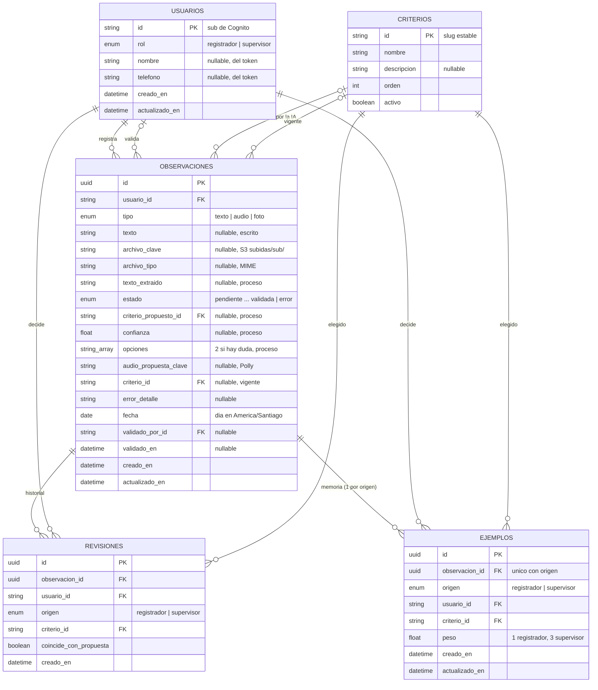
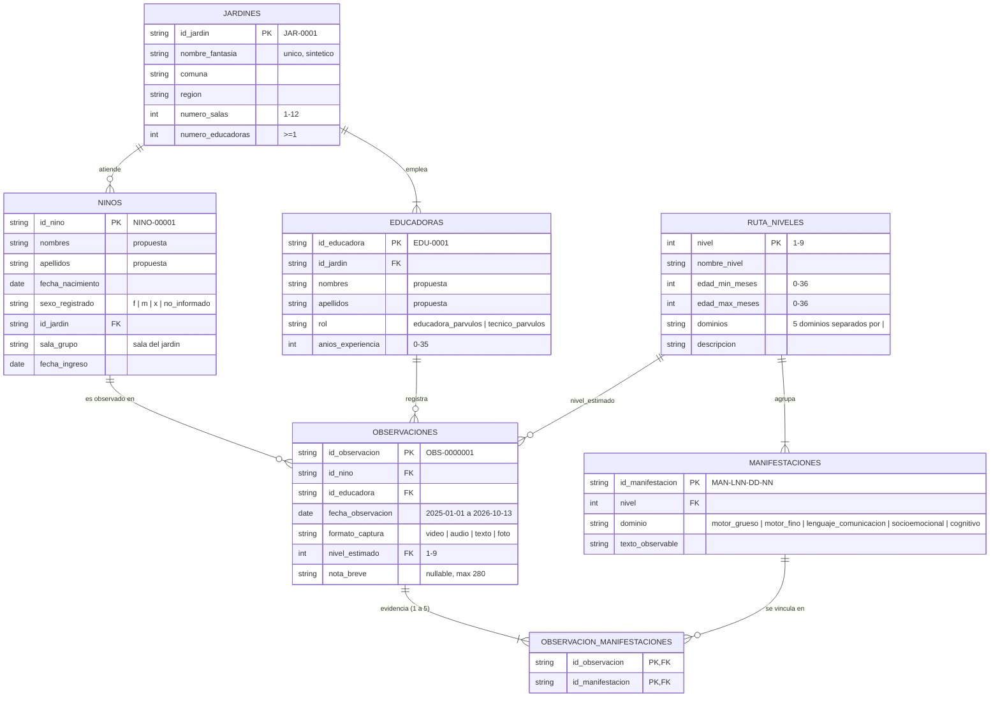

# Modelo de datos

Dos partes:

1. **Modelo implementado** (`apps/api/prisma/schema.prisma`): lo que usan la Lambda API y la Lambda de proceso según la arquitectura v1.
2. **Dataset E-1** (`../diccionario_datos.md` y `../datos_publicos/*.csv`): aún no se carga en la base.

## 1. Modelo implementado (arquitectura v1)

### Quién escribe qué

| Tabla / columnas | Lambda API | Lambda de proceso |
| --- | --- | --- |
| `usuarios` | Crea o actualiza en cada petición autenticada (con caché por contenedor) | Lee |
| `observaciones`: creación, `estado` de revisión y validación, `criterio_id`, `validado_*` | Escribe | Lee |
| `observaciones`: `procesando`, `propuesta`, `error`, `texto_extraido`, `criterio_propuesto_id`, `confianza`, `opciones`, `audio_propuesta_clave` | Lee | Escribe |
| `revisiones` | Agrega una fila por cada confirmación, corrección o validación | — |
| `ejemplos` | Guarda el último criterio por origen | Lee para buscar ejemplos parecidos |
| `criterios` | Lee | Lee |

### Estados de una observación

`pendiente` → `procesando` → `propuesta` → `confirmada` | `corregida` → `validada`, y `error` si el proceso falla.

- El registrador puede revisar desde `propuesta`, `confirmada`, `corregida` o `error`. Si está `validada`, recibe 409.
- El supervisor puede validar desde esos mismos estados y también volver a cambiar una ya validada.
- Con `pendiente` o `procesando` ambos reciben 409: todavía no hay propuesta.

### Pendiente para la Lambda de proceso

- Agregar el vector (`embedding vector(N)`, pgvector) a `observaciones`. La búsqueda de ejemplos une `ejemplos` con `observaciones` por `observacion_id`.
- pgvector exige la imagen `pgvector/pgvector:pg17` en `docker-compose.yml`. Aurora ya lo incluye.
- Cargar la lista fija de `criterios`: todavía no está definida.

## 2. Dataset E-1 (no cargado en la base)

Las columnas marcadas como **propuesta** no vienen del dataset.

### Reglas que el diagrama no muestra

- Cada observación se vincula con 1 a 5 manifestaciones únicas **del mismo nivel** que su `nivel_estimado`.
- La educadora de una observación y el niño/a pertenecen al mismo jardín (verificado en las 2 950 observaciones del dataset).
- `fecha_ingreso` ≤ primera observación del niño/a.
- Edad en meses (derivada, en `consolidado.json`): `12*(año_obs-año_nac)+(mes_obs-mes_nac)-1[día_obs<día_nac]`.

### Propuesta: nombres

- `nombres` y `apellidos` en `educadoras` y `ninos`. El dataset no los trae: el seed debe generarlos sintéticos.
- Los IDs (`NINO-…`, `EDU-…`) siguen siendo la clave; el nombre es solo para mostrar y para que la Lambda de proceso identifique al niño/a mencionado en una captura.
- Son datos personales: no enviarlos al modelo de IA ni a logs más allá de lo necesario para identificar al niño/a.
- Si se cargan estas tablas, `usuarios` puede enlazarse con `educadoras` mediante un `id_educadora` opcional y único.

### Volumen del dataset

| Tabla | Filas |
| --- | --- |
| jardines | 20 |
| educadoras | 80 |
| ninos | 500 |
| ruta_niveles | 9 |
| manifestaciones | 90 |
| observaciones | 2 950 |
| observacion_manifestaciones | 8 850 |
