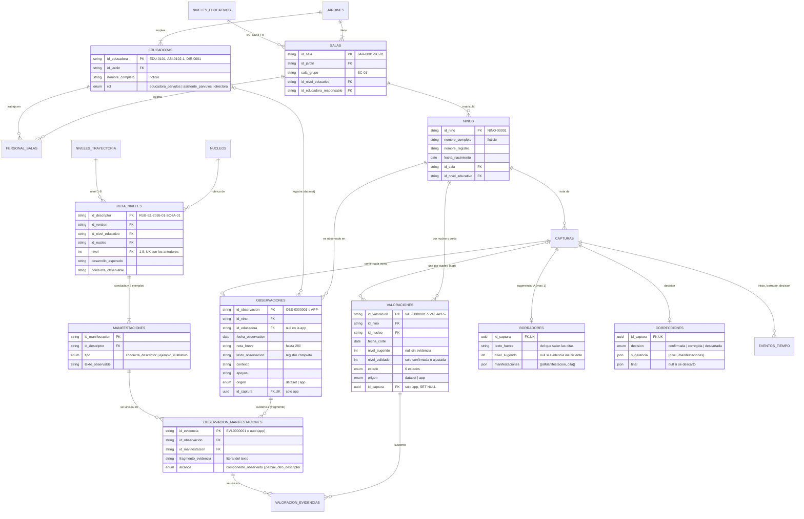

# Modelo de datos

Esquema de `apps/api/prisma/schema.prisma`:

- **Tablas del dataset E1 por núcleos** (v1.0.0, cambio `migrar-dataset-nucleos`). Su fuente es `diccionario_datos.md` del dataset.
- **Tablas del registro en la app** (`definir-mvp-e1`, D4).

El dataset se carga con `pnpm db:seed` desde `DATASET_DIR` (en local) o con `pnpm aws:prod:seed` (en Aurora).

Tablas omitidas en el diagrama:

- **Catálogos:** `nucleos`, `niveles_educativos`, `niveles_trayectoria` y `versiones_rubrica`.
- **Del registro en la app:** `capturas` y `eventos_tiempo`, sin cambios.

Columnas completas en `schema.prisma`.

## Flujo de una captura

`procesando` → `borrador_listo` → `confirmada` | `descartada`, y `error` si el pipeline falla.

1. `POST /capturas` crea la captura y el evento `inicio`. Audio y foto reciben un PUT firmado; en modo `aws` el texto se guarda en S3 como `.txt`.
2. El pipeline (o el modo `inline` con el proveedor `fake`) entrega el borrador por `POST /interno/capturas/:id/borrador`. Es idempotente: un solo borrador por captura.
3. La educadora que registró confirma (con o sin cambios) o descarta. En ambos casos queda una fila en `correcciones` con la sugerencia y la decisión. Confirmar crea:
   - la observación `origen = app`, con el texto fuente y una evidencia por manifestación;
   - **una valoración por núcleo** (`origen = app`, `fecha_corte` igual al día de la captura), con `nivel_sugerido` del borrador si proponía ese núcleo y `nivel_validado` de la educadora. Su estado es `confirmada` si coinciden y `ajustada` si no.

## Reglas

- El nivel (1–8) es una posición **dentro** de un núcleo, un nivel educativo y una versión de rúbrica. No se compara entre núcleos ni se convierte desde la ruta anterior de 9 niveles.
- Una observación no tiene nivel global: el nivel vive en `valoraciones`, por niño o niña, núcleo y fecha de corte.
- Al confirmar y al recibir un borrador, la API exige:
  - 1 a 5 manifestaciones **del mismo nivel**;
  - todas del **nivel educativo del niño o niña**;
  - que cada cita aparezca literalmente en `texto_fuente`.
- `nivel_validado` solo existe en `confirmada` y `ajustada`. Una propuesta pendiente no reemplaza una decisión validada.
- Al borrar una captura se conservan la observación y la valoración confirmadas; su `id_captura` queda en null.
- Los rangos de edad de `niveles_educativos` son contexto de matrícula, no umbrales de logro.
- Edad en meses: `12*(año_obs-año_nac)+(mes_obs-mes_nac)-1[día_obs<día_nac]`.
- Los nombres de niños, niñas y personal son ficticios y vienen del dataset. En un sistema real serían datos personales: no se envían al modelo de IA.

## Pendiente

- Embeddings en pgvector (D10, opcional): requiere la imagen `pgvector/pgvector:pg17` en local.
- `usuarios` no existe: la identidad sale del token y cada captura guarda `id_usuario` y `autor`.

## Volumen del dataset (v1.0.0)

| Tabla | Filas |
| --- | --- |
| niveles_educativos · nucleos · niveles_trayectoria · versiones_rubrica | 3 · 8 · 8 · 1 |
| jardines · salas · educadoras · personal_salas | 3 · 18 · 57 · 54 |
| ninos | 252 |
| ruta_niveles (descriptores) | 192 |
| manifestaciones | 576 |
| observaciones | 11 400 |
| observacion_manifestaciones (evidencias) | 13 026 |
| valoraciones | 5 760 (3 cortes) |
| valoracion_evidencias | 13 026 |

No se cargan `resumen_salas`, `resumen_jardines` ni `alertas`: se pueden recalcular a partir de las valoraciones.
