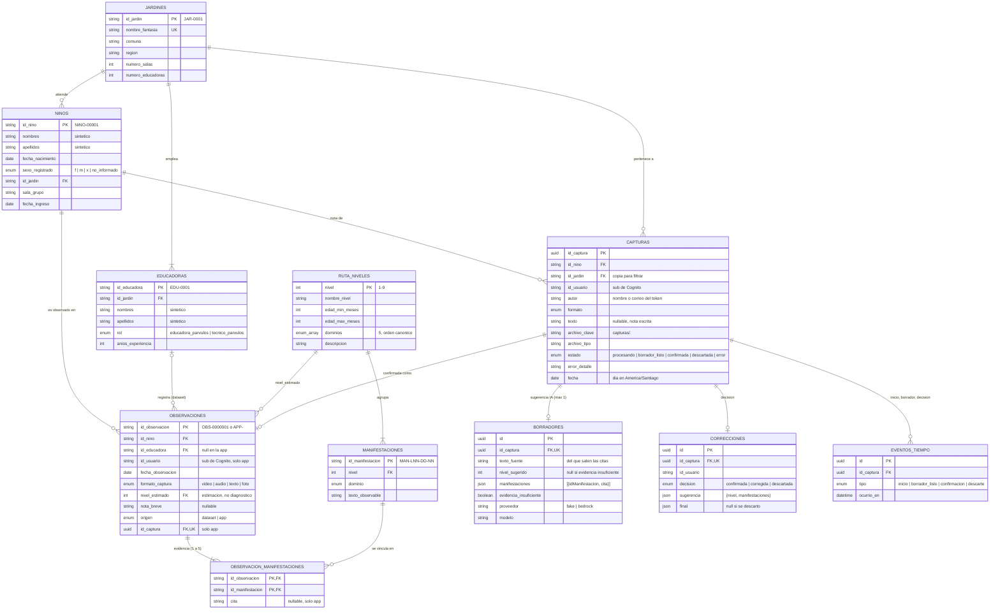

# Modelo de datos

Esquema de `apps/api/prisma/schema.prisma`, según `definir-mvp-e1` (D4): las tablas del dataset E-1 (`../diccionario_datos.md`) más las del registro en la app. El dataset se carga con `pnpm db:seed` desde `DATASET_DIR`.

## Flujo de una captura

`procesando` → `borrador_listo` → `confirmada` | `descartada`, y `error` si el pipeline falla.

1. `POST /capturas` crea la captura y el evento `inicio`. Audio y foto reciben un PUT firmado; en modo `aws` el texto se guarda en S3 como `.txt`.
2. El pipeline (o el modo `inline` con el proveedor `fake`) entrega el borrador por `POST /interno/capturas/:id/borrador`. Es idempotente: un solo borrador por captura.
3. La educadora que registró confirma (con o sin cambios) o descarta. Confirmar crea la observación `origen = app` con sus citas. En ambos casos queda una fila en `correcciones` con la sugerencia y la decisión.

## Reglas

- Cada observación tiene 1 a 5 manifestaciones **del mismo nivel** que su `nivel_estimado`; la API lo exige al confirmar y al recibir el borrador.
- Toda cita del borrador debe aparecer literalmente en `texto_fuente`.
- La educadora de una observación del dataset y el niño o niña pertenecen al mismo jardín (verificado en las 2 950 observaciones).
- Edad en meses: `12*(año_obs-año_nac)+(mes_obs-mes_nac)-1[día_obs<día_nac]`.
- Nombres de niños, niñas y educadoras: sintéticos y deterministas (`apps/api/src/seed/nombres.ts`). Son datos personales en un sistema real: no se envían al modelo de IA.

## Pendiente

- Embeddings en pgvector (D10, opcional): requiere la imagen `pgvector/pgvector:pg17` en local.
- `usuarios` no existe: la identidad sale del token y cada captura guarda `id_usuario` y `autor`.

## Volumen del dataset

| Tabla | Filas |
| --- | --- |
| jardines | 20 |
| educadoras | 80 |
| ninos | 500 |
| ruta_niveles | 9 |
| manifestaciones | 90 |
| observaciones | 2 950 |
| observacion_manifestaciones | 8 850 |
